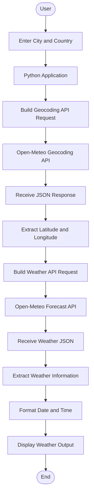

# 🌦️ Python Weather App


<p align="center">
  <strong>A Python-based Weather Application powered by the Open-Meteo API</strong>
  <br>
  Retrieve current weather information for any supported city directly from your application.
</p>

<p align="center">
  
  
  
  
  
</p>

---

## 📌 About the Project

The **Python Weather App** is a Python application that retrieves current weather information using the free [Open-Meteo API](https://open-meteo.com/).

The application follows a two-step API communication process:

1. It sends a city name to the **Open-Meteo Geocoding API** to retrieve the geographical coordinates (latitude and longitude).
2. It uses those coordinates to send a request to the **Open-Meteo Forecast API** and retrieve current weather conditions.

The application processes the JSON response and extracts relevant weather information, including temperature, relative humidity, wind speed, and timestamp.

This project provides hands-on experience with Python fundamentals, HTTP communication, REST APIs, JSON processing, command-line arguments, and date/time formatting.

## ✨ Features

| Feature | Description |
|:---|:---|
| 🔎 City Lookup | Retrieves geographical coordinates using the Geocoding API |
| 🌍 Location Coordinates | Extracts latitude and longitude from the API response |
| 🌡️ Temperature | Retrieves current temperature |
| 💧 Relative Humidity | Retrieves current humidity percentage |
| 🌬️ Wind Speed | Retrieves current wind speed |
| 🕒 Timestamp Formatting | Converts API timestamps into readable date and time |
| 🔗 REST API Integration | Communicates with external APIs using HTTP GET requests |
| 📦 JSON Processing | Parses API responses and extracts nested values |
| 💻 Python Application | Demonstrates command-line and Python programming concepts |

## 🧰 Technology Stack

| Technology | Purpose |
|:---|:---|
| 🐍 Python | Core application programming language |
| `argparse` | Reads command-line arguments |
| `requests` | Sends HTTP GET requests |
| `json` | Processes JSON response data |
| `datetime` | Parses and formats timestamps |
| Open-Meteo Geocoding API | Finds city coordinates |
| Open-Meteo Forecast API | Retrieves current weather information |

---

## 🏗️ Application Architecture

The application uses a simple API-based architecture.



## 🔄 Application Workflow

The complete execution process is divided into the following stages:

### 1. Read User Input

The application accepts city and country as positional command-line arguments using Python's `argparse` module.

Example:

```bash
python weather.py Bengaluru India
```

### 2. Send Geocoding Request

The application sends an HTTP GET request to the Geocoding API with the city name.

### 3. Extract Location Coordinates

The API returns a JSON response containing location details.

The application extracts:

- Latitude
- Longitude

These coordinates are required for the weather API request.

### 4. Send Weather Request

The application sends another HTTP GET request using the extracted latitude and longitude.

It requests the following current weather variables:

- Temperature
- Relative humidity
- Wind speed

### 5. Process API Response

The response is converted into a Python dictionary using `.json()`.

The required values are extracted from nested dictionaries.

### 6. Format Timestamp

The API timestamp is parsed using `datetime.fromisoformat()` and formatted using `strftime()`.

### 7. Display Weather Information

Finally, the application displays the current weather information in a readable format.

---

## 🌐 APIs Used

This project uses two free APIs provided by Open-Meteo.

### 📍 1. Open-Meteo Geocoding API

<badge>Location Search API</badge>

**Purpose:** Converts a city name into geographical coordinates.

**Endpoint:**

```text
https://geocoding-api.open-meteo.com/v1/search
```

**Request Parameters:**

| Parameter | Description | Example |
|:---|:---|:---|
| `name` | City name | Bengaluru |
| `count` | Number of results | 1 |
| `language` | Response language | en |
| `format` | Response format | json |

**Example Response (simplified):**

```json
{
  "results": [
    {
      "name": "Bengaluru",
      "latitude": 12.9716,
      "longitude": 77.5946,
      "country": "India"
    }
  ]
}
```

**Application extracts:**

```python
lat = json_data["results"][0]["latitude"]
long = json_data["results"][0]["longitude"]
```

### 🌤️ 2. Open-Meteo Forecast API

<badge>Weather Data API</badge>

**Purpose:** Retrieves current weather information using geographical coordinates.

**Endpoint:**

```text
https://api.open-meteo.com/v1/forecast
```

**Request Parameters:**

| Parameter | Description |
|:---|:---|
| `latitude` | Geographical latitude |
| `longitude` | Geographical longitude |
| `current` | Current weather variables |

**Current Weather Variables:**

```python
"current": "temperature_2m,relative_humidity_2m,wind_speed_10m"
```

**Example Response (simplified):**

```json
{
  "current": {
    "time": "2026-10-30T08:30",
    "temperature_2m": 25.0,
    "relative_humidity_2m": 68,
    "wind_speed_10m": 10.4
  }
}
```

**Application extracts:**

```python
temperature = wea_json_res["current"]["temperature_2m"]
humidity = wea_json_res["current"]["relative_humidity_2m"]
wind_speed = wea_json_res["current"]["wind_speed_10m"]
```

---

## 🖥️ Sample Application Output

The following values are illustrative. Actual weather values depend on the API response.

```text
========================================
       🌦️  WELCOME TO WEATHER APP
========================================

Weather Details of Bengaluru, India

📍 Location      : Bengaluru
🌡️ Temperature   : 25.0 °C
💧 Humidity      : 68 %
🌬️ Wind Speed    : 10.4 km/h

🕒 Time          : Friday, 30 October 2026
                  08:30:00 AM

========================================
          WEATHER REPORT COMPLETED
========================================
```

---

## 📂 Project Structure

```text
Weather_API/
│
├── weather.py              # Main Python application
│
├── requirements.txt        # External dependencies
│
├── .gitignore              # Files excluded from Git
│
└── README.md               # Project documentation
```

> If you use Streamlit in the current version, include the Streamlit dependency and launch the application using `python -m streamlit run weather.py` instead of the command-line example above.

---

## ⚙️ Getting Started

### Prerequisites

Make sure the following are installed:

- Python 3.9 or later
- Git
- VS Code or another Python IDE
- Internet connection

### 1️⃣ Clone the Repository

```bash
git clone https://github.com/AKCodes1996/Weather_API.git
```

### 2️⃣ Navigate to the Project Directory

```bash
cd Weather_API
```

### 3️⃣ Create a Virtual Environment

```bash
python -m venv venv
```

### 4️⃣ Activate the Virtual Environment

**Windows PowerShell:**

```powershell
.\venv\Scripts\Activate.ps1
```

### 5️⃣ Install Dependencies

```bash
python -m pip install -r requirements.txt
```

### 6️⃣ Run the Application

For the command-line version:

```bash
python weather.py Bengaluru India
```

For the Streamlit version:

```bash
python -m streamlit run weather.py
```

---

## 🧠 Python Concepts Practised

This project helped practise the following Python concepts:

| Concept | What I Practised |
|:---|:---|
| Variables | Storing API URLs and weather values |
| Dictionaries | Creating API request parameters |
| Lists | Accessing geocoding search results |
| Functions | Using built-in Python and library functions |
| `argparse` | Reading positional command-line arguments |
| `requests` | Sending HTTP GET requests |
| JSON | Parsing API responses |
| Nested Data | Extracting values from nested dictionaries |
| Exception Handling | Understanding potential API and network errors |
| `datetime` | Parsing ISO timestamps |
| `strftime()` | Formatting readable dates and times |
| REST APIs | Understanding request and response communication |

## 🧪 API Testing & Validation Opportunities

The project also provides opportunities to practise software testing concepts.

| Test Scenario | Expected Result |
|:---|:---|
| Valid city name | Geographical coordinates returned |
| Invalid city name | Application should display a meaningful error |
| Empty city input | Application should reject empty input |
| API timeout | Application should handle the timeout |
| HTTP error response | Application should handle unsuccessful responses |
| Empty geocoding results | Application should avoid accessing a missing result |
| Missing weather field | Application should handle incomplete data |
| Valid weather response | Correct weather values should be displayed |

## 🚧 Current Limitations

- The country command-line argument is accepted but is not currently used to filter geocoding results.
- The application assumes that the Geocoding API returns at least one result.
- HTTP errors and network failures need explicit handling.
- API response fields are not yet validated before accessing them.
- Weather values need consistent unit labels.
- The application currently uses only the first geocoding result.

## 🛣️ Planned Improvements

- [ ] Use the country argument to filter city search results.
- [ ] Handle invalid city names and empty API responses.
- [ ] Add request timeout and HTTP error handling.
- [ ] Validate API response fields before accessing them.
- [ ] Display temperature in °C and wind speed in km/h or m/s.
- [ ] Add configurable timezone support.
- [ ] Refactor the application into reusable functions.
- [ ] Add unit tests using `pytest`.
- [ ] Mock API responses during testing.
- [ ] Add automated test reporting.
- [ ] Improve the dashboard UI with Streamlit components.

## 🤝 Contributing

This is a learning project, and suggestions or improvements are welcome.

1. Fork the repository.
2. Create a feature branch.
3. Make your changes.
4. Commit your changes.
5. Open a Pull Request describing your improvement.

## 📄 License

This project is intended for learning and practice. Add an open-source license if you want to define permissions for reuse and distribution.

---

<p align="center">

**Built with Python 🐍**

⭐ If you find this project useful, consider giving the repository a star!

</p>